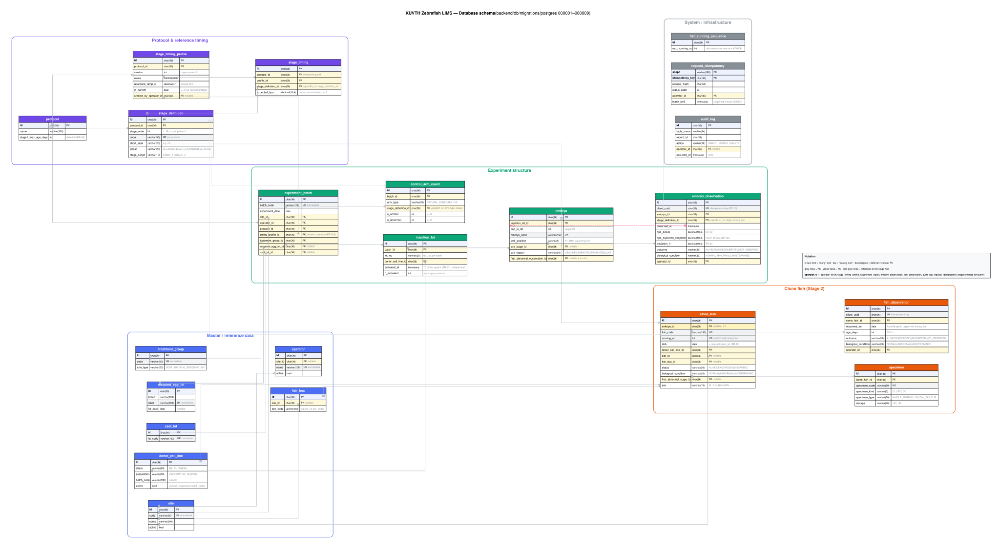

# KUVTH Zebrafish LIMS — Database Schema

**Source of truth:** `backend/db/migrations/postgres/*.up.sql` (migrations `000001`–`000009`).
MySQL 8 mirror lives in `backend/db/migrations/mysql/`. This document is generated
from the applied migrations, not the SRS draft (SRS §5.2 predates migrations
`000003`–`000009`).

- Engine-neutral by design (SRS CON-04 / DR-03): `CHAR(36)` UUIDv7 PKs, `VARCHAR + CHECK`
  instead of native enums, plain `TIMESTAMP`/`DATETIME(3)` holding UTC, no triggers,
  no stored procedures, no materialised views.
- Every table (except the two infra tables) carries `created_at`, `updated_at`,
  `deleted_at` (soft delete) and `row_version BIGINT` (optimistic-lock fence, migration `000005`).
- "Unique among live rows" is done with a generated `*_marker` / `live_marker` column
  (`'0'` while live, `id` once deleted) because MySQL has no partial indexes (SRS §5.8).

---

## Files in this folder

| File | What |
|---|---|
| `README.md` | This document — ERD, table catalogue, per-column list (appendix), design notes. |
| `erd.svg` / `erd.png` | Rendered ERD, grouped by domain (Graphviz). `erd.svg` is the crisp one. |
| `erd.dot` | Graphviz source for the rendered ERD. |
| `erd.mermaid` | Same diagram as Mermaid (also inlined in the appendix below). |

## Entity-relationship diagram

Domains are colour-grouped and laid out left→right along the biological pipeline
(master/protocol → experiment → clone fish). `operator_id` FKs are omitted from
the lines and listed in the diagram legend — every observation/audit table has one.



### Regenerating

```
cd docs/architecture/database
dot -Tsvg erd.dot -o erd.svg
dot -Tpng -Gdpi=140 erd.dot -o erd.png
```

`erd.dot` and `erd.mermaid` are hand-maintained from the migrations. When a migration
adds or changes a table, update both, plus the catalogue below and the Mermaid appendix.

---

## Table catalogue

| Group | Table | Purpose |
|---|---|---|
| **Master** | `site` | Physical facility (`KU`, `MSU`). |
| | `operator` | Lab staff who run batches and record observations. |
| | `donor_cell_line` | Nucleus donor material: strain × preparation × batch. |
| | `recipient_egg_lot` | Enucleated recipient eggs used for SCNT. |
| | `csof_lot` | Culture / activation medium lot. |
| | `treatment_group` | Experimental arm (`CONTROL`, `RK701`, …) with `arm_type`. |
| | `fish_box` | Housing tank for stage-2 fish, scoped per site. |
| **Protocol** | `protocol` | Named protocol + stage-1 promotion cutoff. |
| | `stage_definition` | The 36 developmental checkpoints (1-cell … Day 15), ordered, phased, scoped to stage 1/2. |
| | `stage_timing_profile` | Versioned set of expected timings for a protocol; one `is_current` per protocol. |
| | `stage_timing` | Expected hours-post-activation for each (profile, stage). Composite FK forces profile + stage into the same protocol. |
| **Experiment** | `experiment_batch` | One day's run: site, operator, protocol, **pinned** timing profile, treatment group, optional egg/CSOF lot. |
| | `injection_lot` | An activation event inside a batch. `activated_at` is **T0** for every downstream hpa/age calculation. Nullable only for FR-305 drafts. |
| | `embryo` | Individual embryo produced by a lot; tracks well position and how/when it exited stage 1. |
| | `embryo_observation` | Immutable staged observation. `client_uuid` gives idempotency; `hpa_expected_snapshot` frozen at write; `(embryo, stage)` unique among live rows. |
| | `control_arm_count` | Aggregate normal/abnormal counts for non-SCNT arms at a checkpoint (no per-embryo rows). |
| **Clone fish** | `clone_fish` | Stage-2 fish promoted from an embryo. `dob = date(activated_at)`; `running_no` from `fish_running_sequence`. |
| | `fish_observation` | Daily calendar observation (Asia/Bangkok), one per fish per day among live rows. |
| | `specimen` | Sample taken from a fish (`CL`/`RT`/`DC`), with collection/freeze dates and storage temp. |
| **Infra** | `audit_log` | Append-only change trail; `old_values`/`new_values` as JSON text. |
| | `request_idempotency` | Stores completed API responses per `(scope, key)` plus a `lease_until` single-flight lock (migrations `000003`/`000004`). |
| | `fish_running_sequence` | Single-row counter; `next_running_no` handed out under a `SELECT … FOR UPDATE` row lock so multiple API instances can't collide (migration `000006`). |

## Notable structural choices

- **Composite FKs as consistency guards.** `stage_timing` and `experiment_batch`
  carry a redundant `protocol_id` purely so `(profile_id, protocol_id)` and
  `(stage_definition_id, protocol_id)` FKs can prevent cross-protocol mixing.
- **Circular reference.** `embryo.first_abnormal_observation_id → embryo_observation.id`
  is added with a deferred `ALTER TABLE` at the end of `000001` because
  `embryo_observation` references `embryo`.
- **Pinned timing profile.** `experiment_batch.timing_profile_id` is copied at
  batch creation; later editing a protocol's current profile does not retroactively
  shift expected timings for existing batches (FR-303 / BR-21).
- **No native sequences.** Fish running numbers use a lockable table row, not
  `SERIAL`/`AUTO_INCREMENT`, to stay portable and multi-instance safe.
- **Soft-delete uniqueness.** `embryo_observation`, `fish_observation`,
  `stage_timing_profile`, `embryo.well_position` all use generated marker columns
  to emulate "unique WHERE deleted_at IS NULL" on MySQL.

---

## Appendix — Mermaid source

Renders inline on GitHub; kept in sync with `erd.mermaid`.

```mermaid
erDiagram
    %% ---------- reference / master data ----------
    site ||--o{ operator : employs
    site ||--o{ fish_box : contains
    site ||--o{ experiment_batch : hosts
    site ||--o{ clone_fish : houses

    operator ||--o{ stage_timing_profile : authors
    operator ||--o{ experiment_batch : runs
    operator ||--o{ embryo_observation : records
    operator ||--o{ fish_observation : records
    operator ||--o{ audit_log : acts
    operator ||--o{ request_idempotency : "keyed by"

    %% ---------- protocol & reference timing ----------
    protocol ||--o{ stage_definition : defines
    protocol ||--o{ stage_timing_profile : versions
    protocol ||--o{ stage_timing : scopes
    protocol ||--o{ experiment_batch : governs
    stage_timing_profile ||--o{ stage_timing : contains
    stage_definition ||--o{ stage_timing : "reference for"
    stage_timing_profile ||--o{ experiment_batch : "pinned by"

    %% ---------- experiment structure ----------
    treatment_group ||--o{ experiment_batch : assigns
    recipient_egg_lot ||--o{ experiment_batch : supplies
    csof_lot ||--o{ experiment_batch : "media for"
    experiment_batch ||--o{ injection_lot : contains
    experiment_batch ||--o{ control_arm_count : "aggregate arms"
    donor_cell_line ||--o{ injection_lot : "nucleus source"
    injection_lot ||--o{ embryo : produces

    embryo ||--o{ embryo_observation : "observed at"
    stage_definition ||--o{ embryo_observation : "at stage"
    stage_definition ||--o{ control_arm_count : "at checkpoint"
    stage_definition ||--o{ embryo : "exit checkpoint"
    embryo_observation |o--o| embryo : "first abnormal (circular)"

    %% ---------- clone fish (stage 2) ----------
    embryo ||--o| clone_fish : "promoted into"
    donor_cell_line ||--o{ clone_fish : "derived from"
    fish_box ||--o{ clone_fish : holds
    stage_definition ||--o{ clone_fish : "first abnormal stage"
    clone_fish ||--o{ fish_observation : "observed daily"
    clone_fish ||--o{ specimen : yields

    %% ---------- entities ----------
    site {
        char36 id PK
        varchar20 code UK "normalised"
        varchar200 name
        bool active
    }
    operator {
        char36 id PK
        char36 site_id FK "nullable"
        varchar100 name UK "normalised"
        bool active
    }
    donor_cell_line {
        char36 id PK
        varchar50 strain "AB / TU / NHGRI"
        varchar50 preparation "DISSOCIATED | CHUNKS"
        varchar100 batch_code "nullable"
        bool active
    }
    recipient_egg_lot {
        char36 id PK
        varchar100 breed
        date lot_date "nullable"
        varchar200 label UK "normalised"
    }
    csof_lot {
        char36 id PK
        varchar100 lot_code UK "normalised"
    }
    treatment_group {
        char36 id PK
        varchar50 code UK "normalised"
        varchar20 arm_type "SCNT | NATURAL_BREEDING | IVF"
    }
    fish_box {
        char36 id PK
        varchar50 box_code "unique per site"
        char36 site_id FK "nullable"
    }

    protocol {
        char36 id PK
        varchar200 name
        int stage1_max_age_days "default 5, BR-09"
        bool active
    }
    stage_definition {
        char36 id PK
        char36 protocol_id FK
        int stage_order "1..36, unique per protocol"
        varchar50 code UK "per protocol"
        varchar100 label "English, e.g. 2-cell"
        varchar20 short_label
        varchar20 phase "CLEAVAGE|BLASTULA|GASTRULA|LARVAL"
        varchar10 stage_scope "STAGE_1 | STAGE_2"
    }
    stage_timing_profile {
        char36 id PK
        char36 protocol_id FK
        int version "unique per protocol"
        varchar200 name
        decimal reference_temp_c "default 28.5"
        bool is_current "<=1 live row per protocol"
        char36 created_by_operator_id FK "nullable"
    }
    stage_timing {
        char36 id PK
        char36 protocol_id FK "composite guard"
        char36 profile_id FK
        char36 stage_definition_id FK
        decimal expected_hpa "hours post-activation, >=0"
    }

    experiment_batch {
        char36 id PK
        varchar100 batch_code UK "normalised"
        date experiment_date
        int day_no "nullable"
        char36 site_id FK
        char36 operator_id FK
        char36 protocol_id FK
        char36 timing_profile_id FK "pinned at creation, FR-303"
        char36 treatment_group_id FK
        char36 recipient_egg_lot_id FK "nullable"
        char36 csof_lot_id FK "nullable"
        decimal incubation_temp_c "recorded, unused v1"
    }
    injection_lot {
        char36 id PK
        char36 batch_id FK
        varchar20 lot_no "text, unique per batch"
        char36 donor_cell_line_id FK
        int enu_power_pct "nullable"
        timestamp activated_at "T0 of the system, BR-01, nullable for drafts"
        int n_eggs "nullable"
        int n_activated
    }
    embryo {
        char36 id PK
        char36 injection_lot_id FK
        int seq_in_lot "unique per lot"
        varchar150 embryo_code UK
        varchar5 well_position "A1..H12, unique among live"
        char36 exit_stage_id FK "nullable"
        timestamp exit_at "nullable"
        varchar20 exit_reason "DEAD|DEGENERATED|PROMOTED|LOST"
        char36 first_abnormal_observation_id FK "nullable, circular"
    }
    embryo_observation {
        char36 id PK
        char36 client_uuid UK "idempotency key, BR-18"
        char36 embryo_id FK
        char36 stage_definition_id FK "unique per embryo among live"
        timestamp observed_at
        decimal hpa_actual "BR-02"
        decimal hpa_expected_snapshot "frozen at write, BR-03"
        decimal deviation_h "BR-04"
        varchar20 outcome "ALIVE|DEAD|DEGENERATED|NOT_OBSERVED"
        varchar20 biological_condition "NORMAL|ABNORMAL|UNDETERMINED"
        char36 operator_id FK
        bool is_backdated
        varchar500 override_reason "required on monotonic override, FR-420"
    }
    control_arm_count {
        char36 id PK
        char36 batch_id FK
        varchar20 arm_type "NATURAL_BREEDING | IVF"
        char36 stage_definition_id FK
        int n_normal
        int n_abnormal
    }

    clone_fish {
        char36 id PK
        char36 embryo_id FK "nullable, unique"
        varchar150 fish_code UK
        int running_no UK "system-wide sequence"
        date dob "= date(activated_at), BR-10"
        char36 donor_cell_line_id FK
        char36 site_id FK "nullable"
        char36 fish_box_id FK "nullable"
        varchar20 status "ALIVE|DEAD|FROZEN|DISCARDED"
        varchar20 biological_condition "NORMAL|ABNORMAL|UNDETERMINED"
        char36 first_abnormal_stage_id FK "nullable"
        varchar10 sex "M|F|UNKNOWN"
        bool fin_clipped
        date exit_date "nullable"
        varchar20 exit_reason "DEAD|FROZEN|DISCARDED|LOST"
    }
    fish_observation {
        char36 id PK
        char36 client_uuid UK "idempotency key"
        char36 clone_fish_id FK
        date observed_on "Asia/Bangkok, unique per fish among live"
        int age_days "BR-11"
        varchar20 outcome "ALIVE|DEAD|FROZEN|DISCARDED|NOT_OBSERVED"
        varchar20 biological_condition "NORMAL|ABNORMAL|UNDETERMINED"
        char36 operator_id FK
        bool is_backdated
    }
    specimen {
        char36 id PK
        char36 clone_fish_id FK
        varchar50 specimen_code UK
        varchar5 specimen_kind "CL | RT | DC"
        varchar30 specimen_type "WHOLE_EMBRYO | CAUDAL_FIN_CLIP"
        date collected_on "nullable"
        date frozen_on "nullable"
        varchar10 storage "-20 | -80"
    }

    audit_log {
        char36 id PK
        varchar64 table_name
        char36 record_id
        varchar10 action "INSERT | UPDATE | DELETE"
        text old_values "JSON as text"
        text new_values "JSON as text"
        char36 operator_id FK "nullable"
        timestamp occurred_at
    }
    request_idempotency {
        varchar180 scope PK
        char36 idempotency_key PK
        char64 request_hash
        int status_code
        text response_body
        char36 operator_id FK
        timestamp lease_until "single-flight lease, migration 000004"
        char36 lease_token
    }
    fish_running_sequence {
        char36 id PK
        int next_running_no "allocated under row lock, migration 000006"
    }
```


